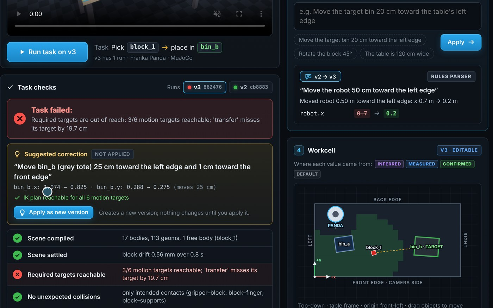
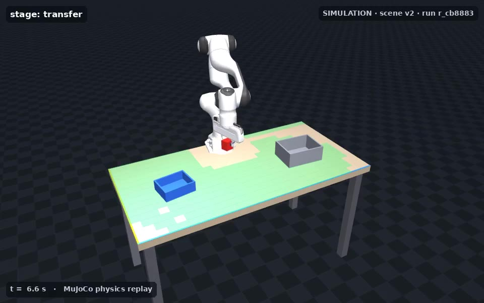
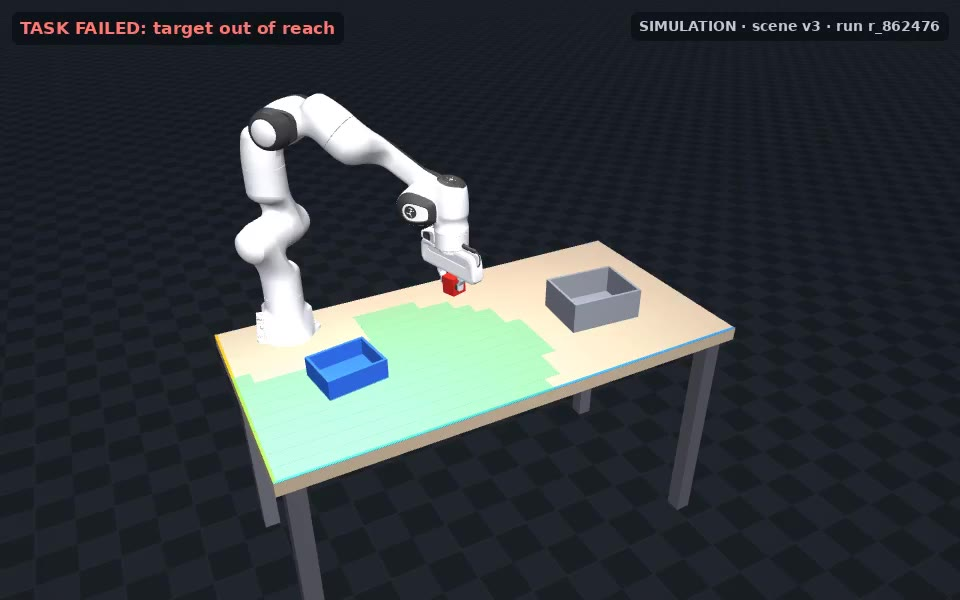
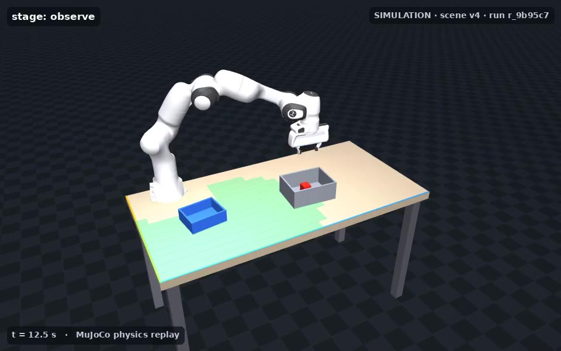
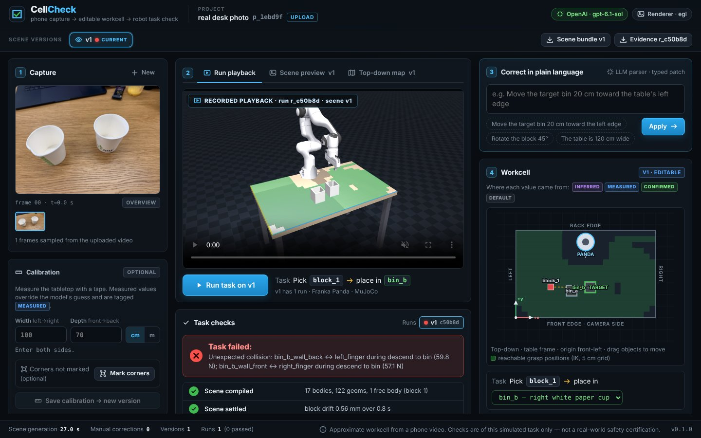
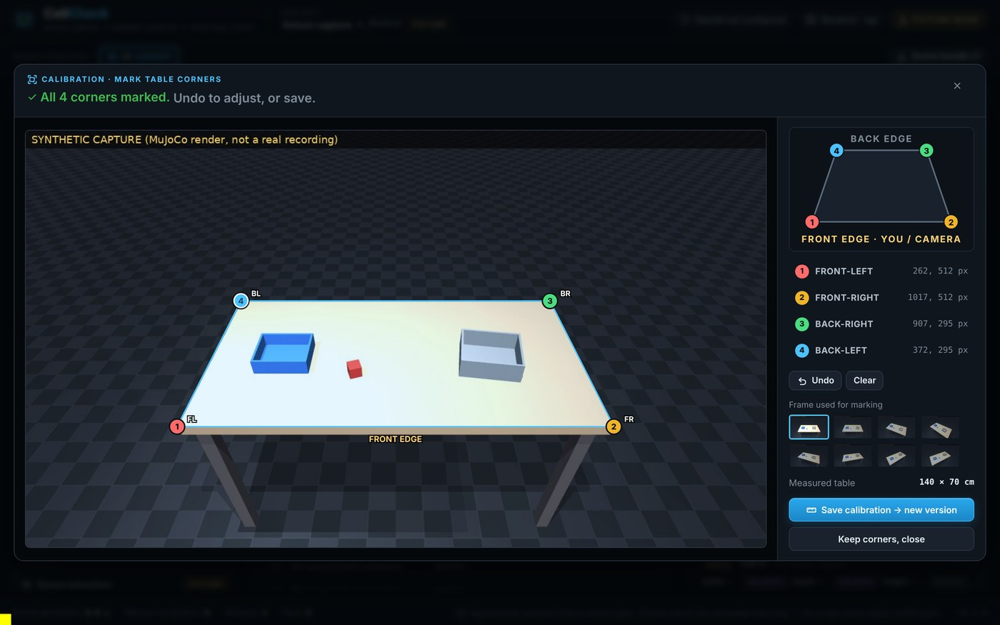
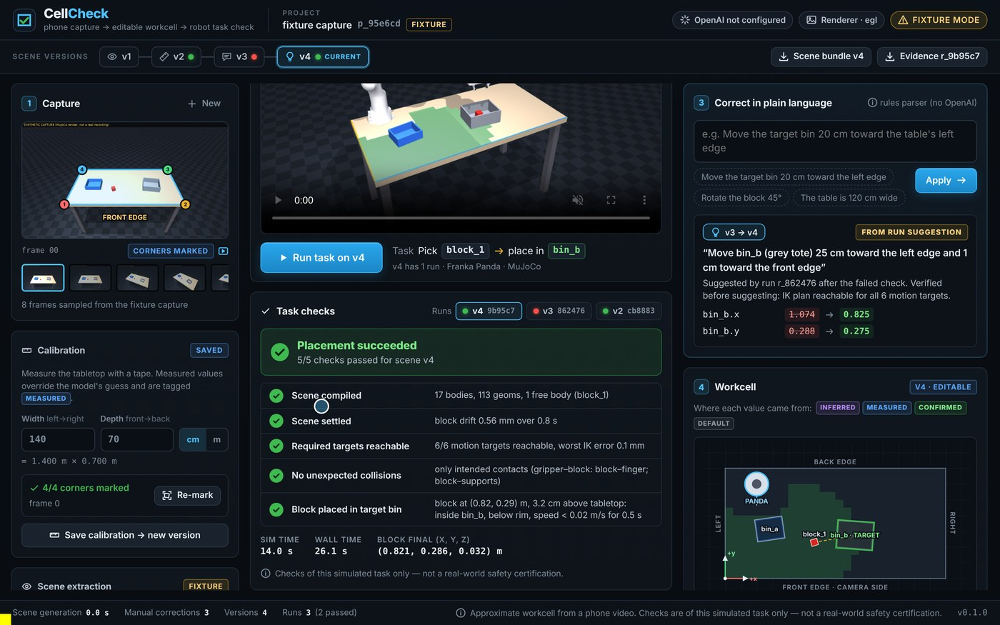

# CellCheck

**Phone capture → editable workcell → robot task check.**

Before you bolt a robot arm to a bench, you want to know: *can it actually do the job here?*
CellCheck turns a short phone video of a workstation into an **approximate, editable MuJoCo workcell**
(table, two open bins, one block, a Franka Panda), runs a scripted pick-and-place in real physics, and
shows **honest, per-check results**. When something is wrong (an estimated position, or a target the arm
can't reach) you correct the scene in plain language, e.g. *"Move the target bin 20 centimetres toward the
table's left edge"*, and CellCheck creates a new scene version and re-runs the checks.

> Built in one day at the Physical AI Hack (London, 17 Oct 2026; Reasoning Project × microagi × Transition × NEA).



| Grasp and lift through contact physics | Robot moved: target outside the green reach zone, so execution halts | Suggestion accepted: placed and at rest |
|---|---|---|
|  |  |  |

**Demo (60 s):** `demo/cellcheck_demo.mp4`. It is a recording of the live app, regenerated by `scripts/record_demo.py` and `scripts/edit_demo.py`.

Video-to-simulation research (e.g. microagi's microSLAM) asks *how faithfully can we reconstruct a scene?*
CellCheck asks a narrower, practical question on top of that: *given an approximate scene, can a robot do
this task, and what has to change if not?* Its focus is the loop around the model: **editable workcells,
transparent assumptions, and visible task checks**.

## What it does

1. **Capture**: upload a 30–60 s phone video. FFmpeg samples ~10 sharp frames.
2. **Extract**: an OpenAI vision model returns a *strict structured* estimate (objects, primitive sizes,
   footprint pixels, table corners). JSON validity is not spatial accuracy, so everything it returns is tagged `inferred`.
3. **Calibrate**: enter the measured table width/depth and click the 4 table corners on the overview frame.
   A homography maps object footprints onto the tabletop. Values are tagged `measured` / `user_confirmed` / `inferred` / `default`.
4. **Compile**: validated scene JSON → MJCF by ordinary code (no model-written XML). Fixed table, bins and
   robot; a free joint only on the block; bins are a floor plus four walls; full sizes → MuJoCo half-extents.
   The scene is loaded and **settled** before any task runs.
5. **Run**: Mink IK plans *approach → descend → close → lift → transfer → descend → open → retreat* from the
   current scene coordinates on a separate robot-only model. Execution writes **only actuator commands**
   and steps MuJoCo. The block moves through contact friction alone: no teleporting, no welds, no disabled
   collisions, normal gravity.
6. **Check**, reported separately: scene compiled · scene settled · required targets reachable · no unexpected collisions · block placed.
   Placement passes only when the block is inside the target bin, below its rim, and slower than 0.02 m/s
   for 0.5 s after release and retreat.
7. **Stress the assumptions**: after a pass, CellCheck runs an **uncertainty check**. It re-runs the physics on 8
   variants whose poses are jittered according to their provenance: inferred/default values by ±3 cm and ±8°
   (about the calibration error we measured), measured/confirmed values by ±0.5 cm and ±2°. It reports
   "8/8 perturbed variants pass" (robust) or flags the layout as sensitive. This is a sensitivity check, not a guarantee.
8. **Fix**: when a target is out of reach, CellCheck searches for the smallest move that makes the whole plan
   reachable and **suggests** it (verified by IK). It never applies it silently. Typed corrections become
   validated patches against stable object IDs; unrelated objects are preserved, and previous runs are marked stale.

Every run is bound to an immutable scene version and stores its evidence: input frames, model response,
scene JSON, compiled MJCF, results, and the rendered MP4 (downloadable as a zip).

*These are checks of this simulated task with an approximate model. They are not an accurate reconstruction,
not a real-world safety certification, and not evidence of sim-to-real transfer.*

## Quick start

```bash
./run.sh            # creates .venv, installs pinned deps, picks a headless renderer, serves http://localhost:8000
```

Requirements: Python 3.11+, FFmpeg, and a CPU. Rendering is headless via EGL, falling back to OSMesa on Linux,
or CGL on macOS. No GPU, display, microphone or robot is needed.

* **No API key?** Everything except real vision extraction works. Use a **sample scene**, or the clearly
  labelled **synthetic capture** (a MuJoCo-rendered "phone video" with a canned model response; see
  `fixtures/synthetic_capture/`). The UI shows a `FIXTURE` badge, and fixture data is never substituted for an upload.
* **Real capture:** put `OPENAI_API_KEY=...` in `.env` (see `.env.example`; the model is configurable via
  `OPENAI_VISION_MODEL`). Keys stay server-side.

Command-line demo of the full loop (no browser): `python scripts/demo_story.py`. Tests: `python -m pytest tests -q`.

## Coordinate frame (table frame)

Stand at the table's **front edge** (where the camera operator stands). Origin = **front-left corner** of the
tabletop; **+x → right edge**, **+y → back edge**, **+z up**. Metres; sizes are full extents; yaw only.
"Toward the left edge" means −x. The front edge is drawn blue and the left edge orange in renders.

## Measured results (what we actually observed)

| What | Result |
|---|---|
| Baseline, alternate (side-mounted robot, block starting in a tray, rotated tote) | both pass all 5 checks |
| Unreachable layout | fails `reachable`; execution halts before the transfer; a suggestion is produced |
| Random target-bin placements inside the reach map (36 runs, random yaw; `scripts/sweep_layouts.py`) | 35/36 succeed. The 1 failure is a real hand–bin-wall collision (bin placed against the block), correctly flagged |
| **Live vision model** (`gpt-6.1-sol`, OpenAI structured outputs) on the synthetic capture video, through the real upload path (`scripts/eval_vision.py`) | upload + FFmpeg sampling 5.5 s (10 frames); extraction 39 s; **total generation 44.6 s**. The model found all 3 objects, labelled them correctly, and picked the right target. Its table corners were within ~30 px. Sizes were close (cube 4.0 vs 4.5 cm; blue tray exactly 20×16 cm), heights were underestimated (4 vs 6 cm, 5 vs 8 cm), and it guessed the table as 1.2 m wide (true 1.4) |
| Position error of that live extraction vs ground truth | **5–14 cm** from the model alone → **0.5–1.2 cm** after entering the measured table size (using the model's own corner estimates, no clicking). The resulting scene passes the task (8/8 uncertainty variants) |
| LLM-parsed correction (free-form text the rules don't match) | *"the grey tray sits a hand's width closer to me than you think, maybe 8 cm"* → patch `bin_b.y −0.08` (toward the front/camera edge) in 3.9 s, validated, new version, rerun passes |
| Calibration on the synthetic capture (canned fixture pixels with ~6 px noise) | object position error **4–14 cm** from the model's metric guess alone → **0.2–2.7 cm** after 4-corner + measured-size calibration |
| Demo story (capture → calibrate → run → move robot → unreachable → accept suggestion → run) | 4 scene versions, 3 manual corrections (calibration, typed correction, accepted suggestion), 13–25 s per run on a 4-core CPU (physics + IK ≈ 1–2 s; the rest is MP4 rendering) |
| Fresh `git clone` → `./run.sh` → `scripts/demo_story.py` | installs pinned deps, auto-selects EGL, and the full story passes |
| Uncertainty check (8 perturbed variants) | baseline, alternate, and demo-story v2/v4 are all 8/8 robust (≈3 s for 8 physics rollouts on 4 cores) |
| What the uncertainty check caught in our own controller | its first run flagged the suggested fix as **sensitive (6/8)**: the 20 cm hand housing cleared the tote rim by only 1.25 cm at release, so a few cm of pose error made it clip the wall. We raised the release height to keep 3 cm clearance and required ≥5 cm reach margin for suggestions, after which all were 8/8 |
| Test suite | 67 passed, including the live OpenAI test when `OPENAI_API_KEY` is set (it skips otherwise) |

The calibration figures come from a *synthetic* render with simulated pixel noise. They show that the pipeline maps
pixels correctly. They do not measure real-world accuracy.

## Modelling assumptions (all surfaced in the UI as provenance tags or notes)

* **Gripper force.** Menagerie's Panda hand actuator is a soft position servo that squeezes a 4.5 cm block
  with only ~2 N, while the real Franka Hand is rated 70 N continuous. We stiffen that servo 5× (~11 N; force
  limit unchanged). Without it, the block slid out during fast transfers. The geometry, kinematics and collision
  model of the hand are unchanged, and the grasp is still pure contact friction.
* MuJoCo `noslip_iterations=4`, elliptic friction cones; block mass 0.1 kg and friction 1.0 are defaults
  (tagged `default`) unless the user sets them.
* The robot is not in the capture, so its base pose defaults to the back-edge centre, 10 cm in, facing the front.
  The user must confirm or move it.
* IK reachability tolerance: 6 mm position, 0.08 rad orientation; top-down grasps only. The gripper opens 8 cm,
  and wider blocks fail the reachability check.
* Unexpected collision = any robot–table/bin/floor contact, or a non-finger robot link touching the block, above 0.5 N.

## What was not tested

* The live vision path (upload → FFmpeg sampling → OpenAI structured output → validated scene) **was run end-to-end with
  a live model, but on a synthetic (MuJoCo-rendered) capture**. Accuracy on real phone footage (lighting, clutter,
  lens distortion, occluded corners) has **not** been measured yet.
* Grasp robustness was only checked for the cube sizes used here (4.5 cm). Conveyor motion, other robots,
  policy learning, deformables and LiDAR are out of scope.

## Real-input test: a photo of an actual desk (live vision model)



A real phone photo (two paper cups on a desk, plus a laptop, a snack bar and a juice cup) went through the live pipeline
(`gpt-6.1-sol`, 27 s). The output is deliberately transparent:

* Both paper cups were found as the two open containers (confidence 0.85/0.88). They are modelled as square open bins of
  ~9.5 cm, since the MVP has box primitives only, and their sizes are tagged `inferred`.
* The laptop, snack bar, juice cup and a partly visible container are listed but **not simulated**, each with an
  "is it an obstacle?" warning.
* **No table corners were visible**, so positions are the model's low-confidence metric guesses, and the scene says so.
* **No block was in the photo**, so a clearly labelled **PLACEHOLDER** block was inserted with a warning. Nothing was
  invented silently.
* Running the task gives an informative failure. The block does land inside the cup, but the Panda's fingers hit the
  cup rim at ~60 N on the way down: a paper cup's ~8 cm opening is too narrow for this gripper holding a 5 cm block.
  It is reported as an *unexpected collision*, so the task fails.

This is one photo, not the recommended 30–60 s video with all four corners visible, so the positions are not calibrated
and no accuracy is claimed for it. Original photo: `docs/img/real_desk_photo.jpg`.

## Calibration and the workcell editor





## Architecture

```
web/ (vanilla JS)  ──HTTP──▶  cellcheck/server.py (FastAPI)
                                 ├─ frames.py       FFmpeg sampling, sharpness selection
                                 ├─ vision.py       OpenAI structured outputs → draft Scene
                                 ├─ calibrate.py    4-corner homography, pixel → table frame
                                 ├─ corrections.py  text → validated Patch (rules first, LLM fallback)
                                 ├─ schema.py       Scene / Patch (pydantic, strict, bounded)
                                 ├─ compiler.py     Scene → MJCF (Menagerie Panda), pre-checks
                                 ├─ store.py        immutable versions, runs, evidence
                                 └─ worker.py ──subprocess──▶ sim.py (Mink IK + MuJoCo physics + checks)
                                                              reach.py (reach map, suggested fixes)
                                                              robust.py (provenance-scaled uncertainty check)
                                                              render.py (EGL/OSMesa → MP4, parallel chunks)
```

## Credits

[MuJoCo](https://mujoco.org) · [MuJoCo Menagerie](https://github.com/google-deepmind/mujoco_menagerie) Franka
Emika Panda model (Apache-2.0, vendored in `assets/franka_emika_panda`) · [Mink](https://github.com/kevinzakka/mink) ·
FastAPI · OpenAI API.
